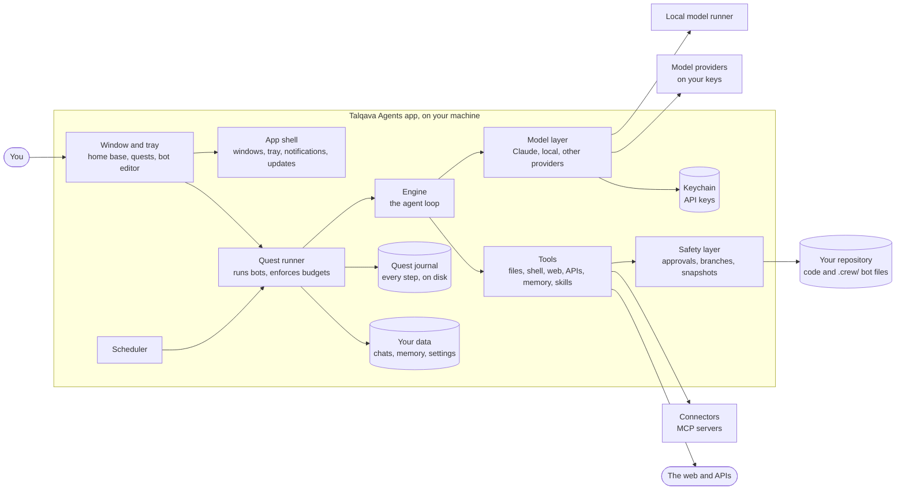

# Talqava Agents: architecture plan

**Status:** plan for review. Stage 0 is built; nothing else here is.

Talqava Agents is an open-source desktop app that gives technical professionals a crew of AI agents with character. Everything runs on the user's own machine, on free local models or the user's own API keys. This document describes how it is built. It replaces the earlier plan for a hosted, multi-user platform, which was dropped.

It follows the [product strategy](https://claude.ai/artifact/B13D3iQxxDGL6Uvmo9j964) and the desktop mockups on the [design canvas](https://claude.ai/artifact/XddAC6ZXtwojVjV2VbMKsM). Where they disagree, the strategy wins and this document is corrected.

## What the architecture has to deliver

The strategy commits to five things that shape every part below.

| Commitment | What it means for the architecture |
| --- | --- |
| A crew, not a chatbot | Several bots run at once, each with its own model, powers, memory and budget |
| Never lose work | Every step of every quest is written down as it happens, so a crash or restart resumes instead of losing results |
| Safe on real code | Bots that change code work on their own branch, every change is previewed, and any quest can be undone |
| Any model | Local models and any provider's key, chosen per bot, with a check of what each model can handle |
| Small and steady | One process, light when idle, updates that can be rolled back |

The last two rows answer the loudest complaints in OpenClaw's and Hermes Agent's issue trackers: crashes, memory leaks, lost work and painful updates.

## What changes from today

| | Today (stage 0) | Planned |
| --- | --- | --- |
| Shape | A local web server you start from the command line | A desktop app with a window, a tray icon and notifications. The command-line start stays for development and the early release |
| Models | Claude only | Claude, local models, and other providers, per bot |
| Agents | One agent | A crew of bots defined as files |
| Running work | One conversation at a time, held in memory | Several quests at once, each recorded step by step and resumable |
| Changes to code | Directly in the working folder | On a separate branch and working copy per quest, with preview and undo |
| Keys | In a settings file | In the operating system's keychain |

## The map



Everything inside the box is one program. Nothing in it talks to a server we run, because there is none.

## The parts

**App shell.** The desktop wrapper: opens the window, keeps a tray icon so scheduled quests run while the window is closed, shows notifications when a bot needs you, and installs updates. Recommended: Electron, because it bundles the same Node.js runtime the engine already uses, so no part of today's code needs rewriting. The lighter alternative, Tauri, would mean a smaller download but running the engine as a separate process alongside it.

**Window.** The screens from the mockups: home base, a quest on code, the bot editor, plain chat, memory, schedules and settings. It grows out of today's local web page, and talks to the rest of the app the same way it talks to today's server.

**Quest runner.** New. It turns "send Pip to compare three queue libraries" into a quest: picks the bot, checks its budget, starts it, and keeps several quests running side by side. It owns the rules that make the crew reliable: a quest's result is always saved, retried or reported, never dropped.

**Engine.** The agent loop that exists today in `src/core/engine.ts`: send the conversation to a model, run the tools the model asks for, repeat. It already takes its tools, settings and storage from outside, so the quest runner can run several copies with different bots.

**Model layer.** New. One interface the engine calls, with an adapter per kind of model:

| Adapter | Covers | Notes |
| --- | --- | --- |
| Anthropic | Claude on the user's key | Today's code. Keeps Anthropic's hosted web search, page reading and conversation compaction |
| OpenAI-compatible | Most local runners, such as Ollama and LM Studio, and many hosted providers | One adapter reaches most of the field, because most offer this common format |

Each model gets a **capability profile**: how reliably it calls tools, follows multi-step plans and handles long tasks. The profile comes from the **model check**, a short fixed test run when a model is first connected, and decides which bot types the bot editor recommends for it.

**Tools.** Today's tools, split as now into those every edition shares (memory, skills, schedules, chat search, API calls) and those that touch the machine (shell, files, browser). Two additions:

- **Our own page reader and an optional search provider,** because Anthropic's hosted web tools only work with Claude.
- **Connectors run on the machine.** Today the app asks Anthropic's servers to call MCP servers, which only works with Claude. The app will connect to MCP servers itself, so connectors work with every model.

**Safety layer.** New, between the tools and the user's files. Described in its own section below.

**Quest journal.** New. Every step of a quest (each model reply, each tool call, each result, each approval) is appended to a file on disk as it happens. If the app crashes or the machine restarts, the runner reads the journal and resumes each quest from its last step. This is the main answer to "lost work", the most common complaint about both competitors.

**Scheduler.** Today's, unchanged in idea: checks every 20 seconds for due quests. It runs while the app is open or in the tray. A quest that came due while the computer was off runs once when the app next starts, and the quest log says so.

## Bots as files

A bot is a small text file. Bots a project shares live in a `.crew/` folder in that project's repository, so a team reviews changes to a bot like any other change. Bots for one person only live in the user's own data folder.

```yaml
# .crew/pip.yaml
name: Pip
type: scout
character: { hat: explorer, colour: blue }
instructions: >
  Research libraries and approaches. Cite every source with a link.
  Say plainly when something could not be confirmed.
model: local            # or a provider and model name, using a stored key
powers: [web, memory, skills]
approvals: ask-before-changes
budget: { spend: 0.50, steps: 40 }
schedule: null
```

The six starter types (Scout, Scribe, Maker, Keeper, Counter, Spark) ship as files of this shape, and anyone can add more as plug-in files. Bots carry no keys: each person's keys stay in their own keychain.

Memory and levels are per person, not in the repository: two people sharing Pip each have their own Pip memory and progress.

## What happens on a quest

1. **Start.** You send a quest from the command palette or a bot's card. The runner loads the bot file, checks its budget, and opens a new journal for the quest.
2. **Prepare.** If the bot may change code, the safety layer creates a branch and a separate working copy of the repository for this quest, so your own working copy and main branch are never touched.
3. **Work.** The engine calls the bot's model, runs the tools it asks for, and writes every step to the journal. The window shows each step live.
4. **Ask.** Actions that change something wait for your approval, unless the bot is allowed them. A dangerous command always waits.
5. **Check.** When the bot says it is done, the runner checks the result where it can: tests pass, the build succeeds, the file exists. Levels and XP are awarded only for checked results.
6. **Review.** Code changes appear as a diff. You accept (which can open a pull request), ask for changes, or undo the whole quest.
7. **Close.** The result goes in the quest log. The journal is kept so the quest can be inspected later.

## The safety model

Several layers, so no single failure causes damage.

| Layer | What it does |
| --- | --- |
| Powers per bot | A bot only has the tools its file grants. A Scout cannot touch files |
| Folder limit | File tools are confined to the quest's working copy; paths outside it are refused, including through symbolic links |
| Branch per quest | Code changes happen on the quest's own branch and working copy, never on your main branch |
| Preview | Every file change shows as a diff before it lands |
| Undo | Removing the quest's branch and working copy puts everything back; files outside the repository are snapshotted before a change |
| Approvals | Changes ask first by default. Dangerous commands (deleting, force-pushing, changing system settings) always ask |
| Caution after the web | Once a quest has read outside content, any change it wants to make needs approval, whatever the bot's settings. This limits what a malicious page can trigger |
| Budgets | Every quest has a spending and step limit; the bot stops and asks when it is reached |
| Secrets | Keys stay in the keychain and are filled in outside the model's view, only for the service each key belongs to. The shell does not inherit them |
| Optional container | For people who want a hard wall, the shell can run inside a container |

A security review by someone outside the project happens before public release.

## Where data lives

| What | Where | Why |
| --- | --- | --- |
| Shared bots | `.crew/` in the project's repository | Reviewed and shared like code |
| Personal bots, chats, memory, skills, levels, quest journals | The user's data folder, as plain files | Readable, easy to back up, nothing leaves the machine |
| API keys | The operating system's keychain | Encrypted by the system; never in a file a bot could read |
| Settings | A settings file in the user's data folder | Editable by hand and from the app |

The app sends nothing to us. There is no account and no usage reporting by default.

## Reliability

| Complaint about competitors | Our answer |
| --- | --- |
| Lost work, sub-agent results lost | The quest journal; every result saved, retried or reported |
| Crashes and memory growth in a long-running service | One process; quests run in isolated workers that are restarted cleanly; idle means no model calls and no polling beyond the scheduler |
| Updates that break a working setup | Updates download in the background, install on restart, and can be rolled back from the settings screen; settings files carry a version and are migrated with a backup |
| Slow, heavy desktop apps | No always-on animation work in the background; characters animate only while visible |

## Code layout

| Folder | Holds | From today |
| --- | --- | --- |
| `src/core` | Engine, quest runner, model layer, shared tools, safety rules, journal | Grows from today's `src/core` |
| `src/local` | Shell and file tools, the scheduler's timer, file storage | Today's `src/local`, minus the web server |
| `src/app` | The desktop shell: window, tray, notifications, updates, keychain | New |
| `src/ui` | The window's screens | Grows from today's `public/` |
| `crew/` | The six starter bot files | New |
| `test` | Unit tests, the quest test suite, the model check | Today's tests stay |

The earlier `src/cloud` placeholder is removed: there is no hosted edition.

## Build order

Matches the build plan in the strategy. Each stage ends with something usable.

| Stage | Architecture work | Done when |
| --- | --- | --- |
| 0. Foundation | Shared core and local edition | Done |
| 1. Any model | Model layer with both adapters; capability profiles and the model check; our own page reader; budgets | A bot runs on a local model and on a Claude key, and stops at its budget |
| 2. The crew, safely | Bot files and `.crew/`; quest runner with several quests at once; quest journal and resume; branch per quest, preview and undo; home base and live crew view | Three bots run at once, one survives an app restart mid-quest, one change is undone cleanly |
| 3. Early release | The five core quests; the quest test suite; local connectors; one-line install that opens the app in a browser | Outside testers install it in one command |
| 4. Desktop app | App shell, tray, notifications, keychain, installers, updates with rollback, one operating system first | Download, double-click, run |
| 5. Public release | Security review, signed installers, documentation, website | Anyone can find, trust and install it |
| 6. Community | Plug-in files for bot types, tools and skills; import and export; a public gallery repository | Others share and extend the crew |

## Testing

- **Unit tests** for every part, as today, with the stand-in model service so tests cost nothing.
- **The quest test suite.** Fixed tasks with known good outcomes, run against each supported model before every release. A release that scores worse does not ship.
- **The model check** doubles as a test that each adapter still talks to its kind of model correctly.
- **Restart tests.** Kill the app mid-quest and confirm the quest resumes with nothing lost.

## What carries over, and what is dropped

**Carries over:** the agent loop, tool definitions and input checks, approvals, the folder limit, secret handling, schedule parsing, the Markdown renderer, the brand file, and the 20 existing tests.

**Dropped from the earlier hosted plan:** accounts, the Supabase database, hosting on Render, email, the job queue and workers, storing other people's keys, and everything about keeping users apart. None of it is needed when everything runs on the user's machine.

## Open technical decisions

| Decision | Options | Recommendation |
| --- | --- | --- |
| Desktop shell | Electron, or Tauri | Electron: no rewrite of the engine |
| First operating system | macOS, Windows or Linux | The one most early testers use; likely macOS |
| Local model runner to test against first | Several exist | The most widely used one, through the shared format |
| Web search for models other than Claude | A paid search service on the user's key, or page reading only | Page reading built in; a search service as an option |
| Bot file format | YAML or JSON | YAML: easier to read and review |
| Where quest work runs | Inside the app process, or a separate process per quest | A separate process per quest, so one runaway quest cannot take the app down |
